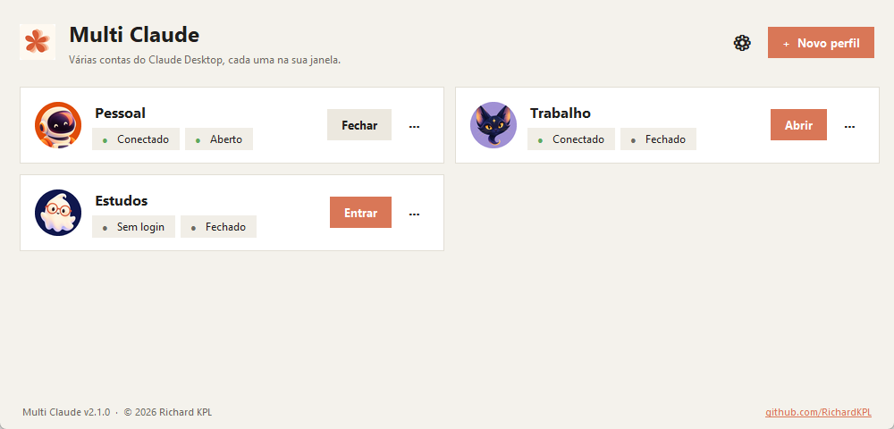
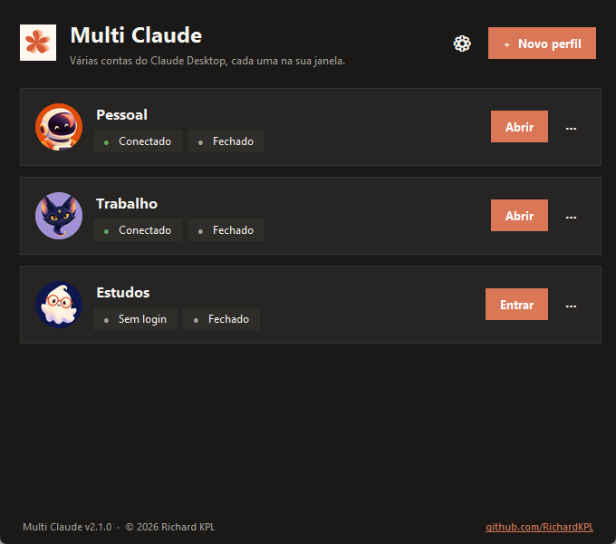
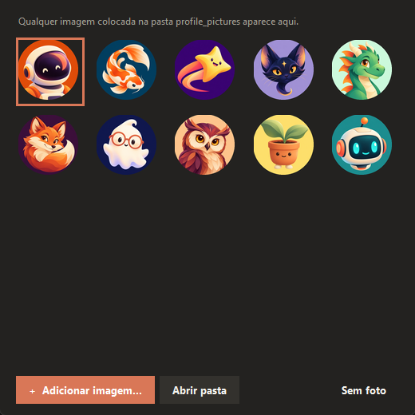
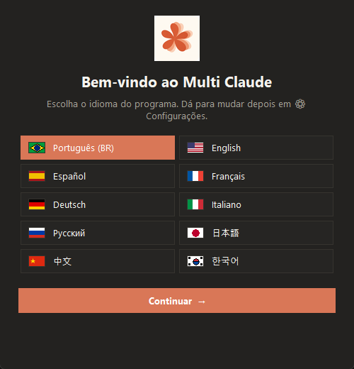
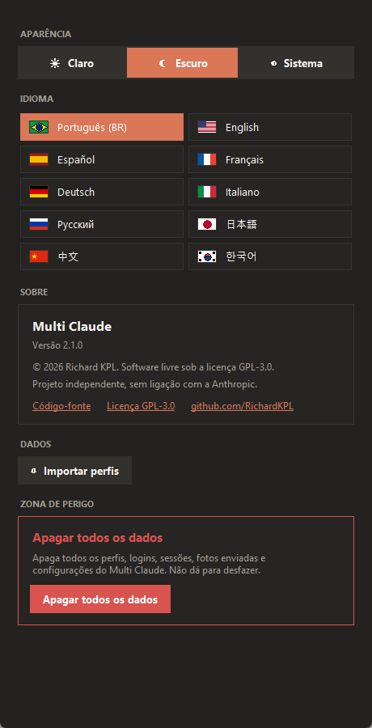

<div align="center">


# Multi Claude

**Run several Claude Desktop accounts side by side — each one in its own window.**

[](https://github.com/RichardKPL/multi-claude/releases/latest/download/Multi-Claude-Portable.exe)
[](LICENSE)
[](#requirements)
[](#download)

[**Website**](https://richardkpl.github.io/multi-claude/) ·
[**Download**](https://github.com/RichardKPL/multi-claude/releases/latest) ·
[**How it works**](#how-it-works) ·
[**License**](#license--credits)



</div>

---

## ✨ Features

| | |
|---|---|
| 👥 **Unlimited profiles** | Every profile is a separate Claude Desktop with its own sign-in, sessions and settings. |
| 🔐 **Automatic Google sign-in** | Click *Sign in*, pick the account in your browser and you're done — the sign-in lands in the right profile without popping up your main Claude. |
| 🟢 **Live status** | See which profiles are signed in and which are open; open and close each one with a single click. |
| 🖼️ **Profile pictures** | Built-in gallery plus your own images. Any image dropped into `profile_pictures` becomes an option. |
| 🎨 **Light, Dark or System** | Follows the Windows theme live — title bar included. |
| 🌍 **10 languages** | Português, English, Español, Français, Deutsch, Italiano, Русский, 日本語, 中文, 한국어. |
| 📦 **Fully portable** | A single `.exe`. All data lives next to it — carry it on a USB drive. |
| ⇩ **Profile import** | Finds Claude profiles that already exist on the machine (or another `perfis.db`) and imports them. |
| 🧨 **Danger zone** | Erase all Multi Claude data behind a typed confirmation. |
| 📐 **Responsive layout** | One or two columns depending on window size; remembers its size and position. |

<div align="center">


</div>

## ⬇️ Download

1. Download **[`Multi-Claude-Portable.exe`](https://github.com/RichardKPL/multi-claude/releases/latest/download/Multi-Claude-Portable.exe)**.
2. Put it in a folder of its own (e.g. `Documents\Multi Claude`) — that's where your data will be stored.
3. Run it. On first launch it asks for your language and offers to import any profiles it finds.

> Windows SmartScreen may warn about an unknown publisher (the executable is not code-signed). Click **More info → Run anyway**. The full source code is in this repository if you want to review it or build your own `.exe`.

### Requirements

- Windows 10 or 11
- [Claude Desktop](https://claude.ai/download) installed

## 🚀 Usage

1. **+ New profile** → give it a name and pick a picture.
2. **Sign in** → in the Claude window that opens, click *Continue with Google* and choose the account.
   If the browser asks, click *Open Claude*. The rest is automatic.
3. Once signed in, use **Open** / **Close**. The **⋯** menu holds *Profile picture*, *Rename*, *Data folder*, *Sign out* and *Delete*.

<div align="center">


</div>

## ⚙️ How it works

- Each profile runs Claude Desktop with `--user-data-dir=<profile folder>`, so sign-ins and sessions stay isolated.
- **Sign-in:** the browser hands the sign-in back through a `claude://` link. The Microsoft Store build of Claude registers that protocol inside its own package, so Windows always delivers it to the main Claude — for a moment it starts a `Claude.exe` with the link on its command line. While a sign-in is in progress, Multi Claude watches for new processes, reads that link, ends the short-lived process (so the main Claude doesn't pop up) and hands the link to the profile's Claude.
  Nothing ever leaves your computer.
- **Status:** "signed in" comes from the profile's own Claude log; "open" comes from the running processes.
- **Sign out** closes the profile's Claude and deletes cookies and tokens for that profile only.

### Where data lives (portable mode)

```
Multi-Claude-Portable.exe
perfis.db            ← profiles, language, theme (SQLite)
log.txt              ← diagnostic log
dados\<profile>\     ← each profile's Claude data
profile_pictures\    ← default pictures + the ones you add (usuario_*)
```

Paths inside the program folder are stored as relative paths, so you can move the whole folder to another place or another computer.

## 🛠️ Run and build from source

```bash
pip install pillow pyinstaller
pythonw "Multi Claude.pyw"          # run directly
python recursos/build_exe.py        # builds dist/Multi Claude.exe (portable, single file)
```

The generated `.exe` only bundles the icon and the default pictures — never any user data.

```
Multi Claude.pyw        application source
recursos/               icon and build script
profile_pictures/       default profile pictures
docs/                   website (GitHub Pages)
LICENSE · NOTICE        GPL-3.0 license + attribution terms
```

## 📄 License & credits

## 🌐 Website

The website is published from the `docs/` folder by the GitHub Actions workflow in `.github/workflows/pages.yml`. In the repository settings, set **Pages → Build and deployment → Source** to **GitHub Actions**. The site detects the visitor's browser language on first visit, falls back to English when it is not supported, and also provides a manual language selector.

**Multi Claude © 2026 [Richard KPL](https://github.com/RichardKPL)** — free software under the **[GPL-3.0](LICENSE)** with the additional terms in **[NOTICE](NOTICE)**.

You may use, study, modify and redistribute it. If you publish a modified version, it **must**:

- remain open source under the GPL-3.0;
- keep visible, in the app and in the README: *"Based on Multi Claude, created by Richard KPL"* with a link to this repository;
- keep the `LICENSE` and `NOTICE` files;
- be clearly marked as a modified version.

> **Disclaimer:** "Claude" and "Claude Desktop" are trademarks of Anthropic, PBC. Multi Claude is an independent project and is **not affiliated with, endorsed by or sponsored by Anthropic**. Please use it in accordance with [Claude's terms of service](https://www.anthropic.com/legal/consumer-terms).
